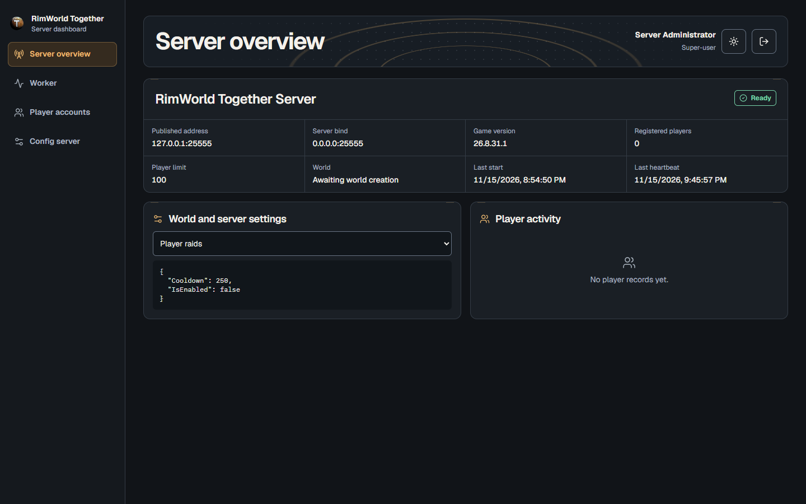
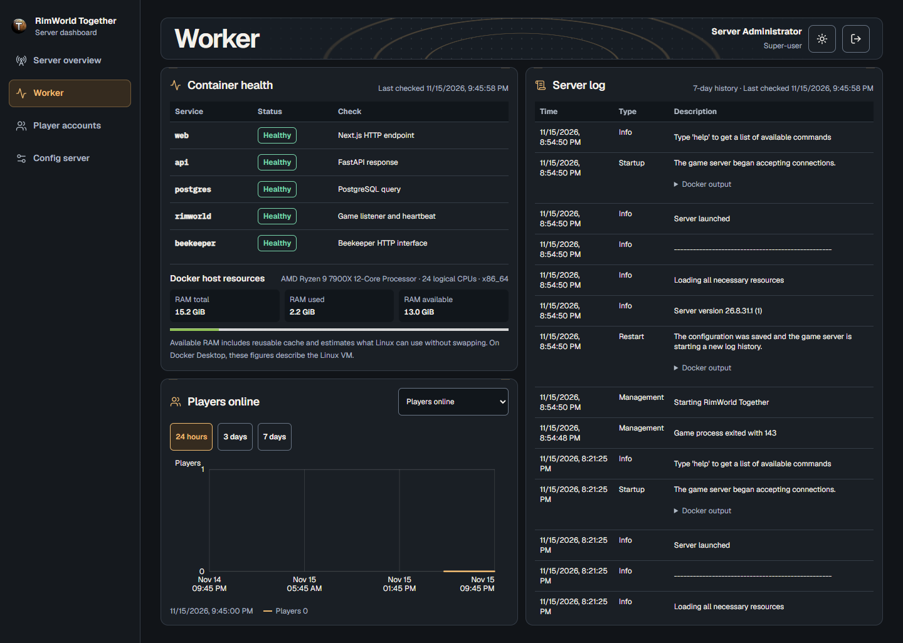

# RimWorld Together on VPS

ติดตั้ง **RimWorld Together Dedicated Server** บน Ubuntu Server 22.04 ด้วย Docker Compose มีแดชบอร์ดสำหรับดูสถานะ กราฟ ผู้เล่น และตั้งค่าเกม รวมถึง Beekeeper Studio สำหรับจัดการ PostgreSQL ผ่าน SSH tunnel



[ติดตั้งบน VPS](#ติดตั้งบน-vps) · [ให้ผู้เล่นเข้าเกม](#ให้ผู้เล่นเข้าเกม) · [เปิดแดชบอร์ดและ-beekeeper-studio](#เปิดแดชบอร์ดและ-beekeeper-studio) · [ดูภาพหน้าเว็บ](#ภาพหน้าเว็บ) · [ดูแลและอัปเดต](#ดูแลและอัปเดต)

## ติดตั้งบน VPS

ใช้ **Ubuntu Server 22.04 x86‑64** พร้อมบัญชีที่ใช้ `sudo` ได้ และเชื่อมต่ออินเทอร์เน็ตเพื่อดาวน์โหลด image กับ dependencies รุ่นเกมที่รวมอยู่ในสแตกคือ **RimWorld Together 26.8.31.1**

รันคำสั่งต่อไปนี้ **บน VPS** หลังเข้า SSH

```sh
sudo apt-get update
sudo apt-get install -y git
git clone https://github.com/EldoriaLizbel/Rimworld-Together-on-VPS.git
cd Rimworld-Together-on-VPS
sh deploy.sh
```

สคริปต์ติดตั้ง Docker Engine และ Compose จากคลังทางการเมื่อยังขาด สร้างไฟล์ตั้งค่าและรหัสผ่านสุ่ม จากนั้น build, migrate ฐานข้อมูล, สร้าง Docker network, เริ่มบริการทั้งห้า และพิมพ์ผลตรวจสุขภาพจนถึง `Ready`

ในการติดตั้งครั้งแรก สคริปต์ใช้ HTTPS ตรวจ **public IPv4 ขาออก** ผ่าน [ipify](https://www.ipify.org/) แล้วพิมพ์ที่อยู่สำหรับเข้าเกม หาก VPS ใช้ NAT, Floating IP, หรือ IP ที่ซื้อไว้ต่างจาก IP ขาออก ให้ระบุ IP หรือ DNS จากแผงผู้ให้บริการเอง

```sh
RIMWORLD_PUBLIC_HOST=203.0.113.10 sh deploy.sh
```

แทน `203.0.113.10` ด้วยที่อยู่จริง หากต้องการเปลี่ยนที่อยู่ที่บันทึกไว้สำหรับการรันครั้งถัดไป ให้แก้ `RIMWORLD_PUBLIC_HOST` ใน `.rwt-deploy/compose.env` แล้วรันสคริปต์อีกครั้ง

## ให้ผู้เล่นเข้าเกม

1. เปิด **TCP 25555** ใน firewall หรือ security group ของผู้ให้บริการ VPS
2. ให้ผู้เล่นเปิด RimWorld พร้อมม็อด RimWorld Together รุ่นที่เข้ากับเซิร์ฟเวอร์ แล้วกรอก public IP/DNS และพอร์ต `25555`
3. ผู้เล่นคนแรกที่สร้างโลกสำเร็จกำหนด map seed ที่ผู้เล่นคนต่อไปจะใช้ร่วมกัน

Public IP ที่ตรวจพบใช้บอกที่อยู่สำหรับเข้าเกม ความพร้อมจากอินเทอร์เน็ตยังขึ้นอยู่กับการกำหนด IP, NAT และ firewall ของผู้ให้บริการ

## เปิดแดชบอร์ดและ Beekeeper Studio

รันบน **เครื่องของคุณ** โดยแทน `ubuntu@203.0.113.10` ด้วยบัญชีและที่อยู่ SSH จริง

```sh
ssh -N -L 10005:127.0.0.1:10005 -L 5800:127.0.0.1:5800 ubuntu@203.0.113.10
```

| บริการ | วิธีเข้า |
| --- | --- |
| Dashboard | [localhost:10005](http://127.0.0.1:10005) บัญชี `rimworldtogether` ใช้ `RIMWORLD_ADMIN_PASSWORD` จาก `.rwt-deploy/postgres.env` บน VPS |
| Beekeeper Studio | [localhost:5800](http://127.0.0.1:5800) เลือก PostgreSQL และต่อไปยัง `postgres:5432` ฐานข้อมูล `app_db` ด้วยบัญชี `rimworld_web` และค่า `RIMWORLD_WEB_DB_PASSWORD` จากไฟล์เดียวกัน |

Beekeeper GUI ใช้ SSH tunnel จำกัดการเข้าถึง ส่วน PostgreSQL ตรวจรหัสผ่านแยกจากบัญชีเว็บ

## ภาพหน้าเว็บ

### Worker

สถานะบริการและ RAM ของ Docker host พร้อมกราฟผู้เล่น/RAM/uptime และ Server log



### Config server

แก้ไขการตั้งค่าตามหมวดในหน้าเดียว กด **Save changes** เพื่อพักค่าไว้ จากนั้นกด **Restart game server** และยืนยันเมื่อต้องการนำค่ามาใช้


## ดูแลและอัปเดต

```sh
# ดูสถานะ
docker compose --env-file .rwt-deploy/compose.env ps

# ติดตาม log เกม
docker compose --env-file .rwt-deploy/compose.env logs -f rimworld

# อัปเดตจาก GitHub
git pull --ff-only
sh deploy.sh
```

สคริปต์ใช้ค่าที่บันทึกไว้เมื่อรันซ้ำ และการอัปเดต image อาจทำให้เกมรีสตาร์ต เก็บสำรอง `.rwt-deploy/` ซึ่งมีข้อมูลเกมและข้อมูลตั้งค่า รวมถึง volume PostgreSQL ของโปรเจกต์ คำสั่ง `docker compose down -v` จะลบ volumes ของโปรเจกต์

หากผู้เล่นเข้าไม่ได้ ให้ตรวจ `docker compose ... ps` ว่า RimWorld ขึ้น Healthy แล้วเทียบ IP/พอร์ตกับหน้าผู้ให้บริการ หากแดชบอร์ดเข้าไม่ได้ ให้ตรวจว่า SSH tunnel ยังเปิดอยู่

อ่านรายละเอียดสแตก ตารางฐานข้อมูล และขั้นตอน nonprod เพิ่มเติมใน [RTenv.txt](RTenv.txt)
