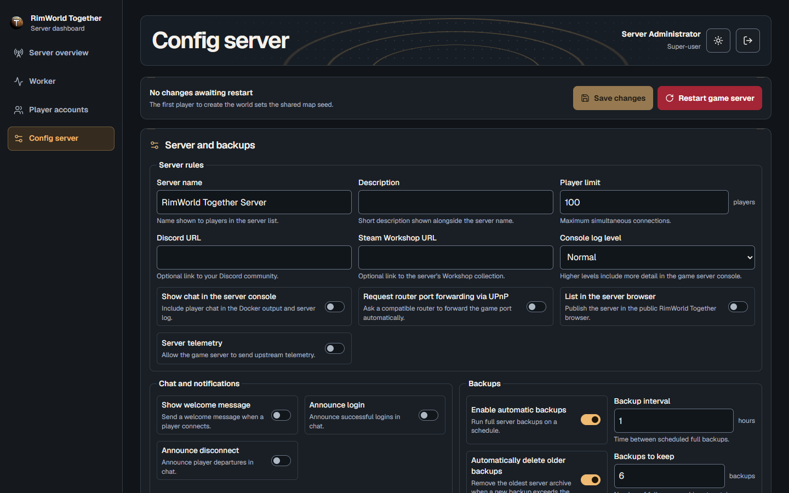

# RimWorld Together on VPS

ติดตั้ง **RimWorld Together Dedicated Server** บน Ubuntu Server 22.04 ด้วย Docker Compose มีแดชบอร์ดสำหรับดูสถานะ กราฟ ผู้เล่น และตั้งค่าเกม


[ติดตั้งบน VPS](#ติดตั้งบน-vps) · [ให้ผู้เล่นเข้าเกม](#ให้ผู้เล่นเข้าเกม) · [เปิดแดชบอร์ด](#เปิดแดชบอร์ด) · [ดูภาพหน้าเว็บ](#ภาพหน้าเว็บ) · [สำรอง กู้คืน และอัปเดต](docs/operations.md)

## ติดตั้งบน VPS

ใช้ **Ubuntu Server 22.04 x86‑64** พร้อมบัญชีที่ใช้ `sudo` ได้ แนะนำ RAM อย่างน้อย 4 GiB และพื้นที่เผื่อ backup เชื่อมต่ออินเทอร์เน็ตเพื่อดาวน์โหลด image และ dependencies รุ่นเกมที่ตรึงไว้คือ **RimWorld Together 26.8.31.1**

รันคำสั่งต่อไปนี้ **บน VPS** หลังเข้า SSH

```sh
sudo apt-get update
sudo apt-get install -y git
git clone https://github.com/EldoriaLizbel/Rimworld-Together-on-VPS.git
cd Rimworld-Together-on-VPS
sh deploy.sh
```

สคริปต์ติดตั้ง Docker Engine และ Compose จากคลังทางการเมื่อยังขาด สร้างไฟล์ตั้งค่าและรหัสผ่านสุ่ม จากนั้น build, ตรวจ migration, เริ่มบริการ และพิมพ์ผลตรวจจากภายใน Docker หากมี release ที่เผยแพร่แล้ว ใช้ `sh deploy.sh --prepare` เพื่อข้ามการ build แล้ว [ติดตั้งจาก GHCR](docs/operations.md#ติดตั้งหรืออัปเดต)

ในการติดตั้งครั้งแรก สคริปต์ใช้ HTTPS ตรวจ **public IPv4 ขาออก** ผ่าน [ipify](https://www.ipify.org/) แล้วพิมพ์ที่อยู่สำหรับเข้าเกม หาก VPS ใช้ NAT, Floating IP, หรือ IP ที่ซื้อไว้ต่างจาก IP ขาออก ให้ระบุ IP หรือ DNS จากแผงผู้ให้บริการเอง

```sh
RIMWORLD_PUBLIC_HOST=203.0.113.10 sh deploy.sh
```

แทน `203.0.113.10` ด้วยที่อยู่จริง หากต้องการเปลี่ยนที่อยู่ที่บันทึกไว้สำหรับการรันครั้งถัดไป ให้แก้ `RIMWORLD_PUBLIC_HOST` ใน `.rwt-deploy/compose.env` แล้วรันสคริปต์อีกครั้ง

## ให้ผู้เล่นเข้าเกม

1. เปิด **TCP 25555** ใน firewall หรือ security group ของผู้ให้บริการ VPS
2. ให้ผู้เล่นเปิด RimWorld พร้อมม็อด RimWorld Together รุ่นที่เข้ากับเซิร์ฟเวอร์ แล้วกรอก public IP/DNS และพอร์ต `25555`
3. ผู้เล่นคนแรกที่สร้างโลกสำเร็จกำหนด map seed ที่ผู้เล่นคนต่อไปจะใช้ร่วมกัน

Public IP ที่ตรวจพบใช้บอกที่อยู่สำหรับเข้าเกม ความพร้อมจากอินเทอร์เน็ตยังขึ้นอยู่กับการกำหนด IP, NAT และ firewall ของผู้ให้บริการ

## เปิดแดชบอร์ด

รันบน **เครื่องของคุณ** โดยแทน `ubuntu@203.0.113.10` ด้วยบัญชีและที่อยู่ SSH จริง

```sh
ssh -N -L 10005:127.0.0.1:10005 ubuntu@203.0.113.10
```

| บริการ | วิธีเข้า |
| --- | --- |
| Dashboard | [localhost:10005](http://127.0.0.1:10005) บัญชี `rimworldtogether` ใช้ `RIMWORLD_ADMIN_PASSWORD` จาก `.rwt-deploy/postgres.env` บน VPS |


หากต้องการเปิด dashboard ผ่าน public IP:10005 ให้เปิดเองตาม [คู่มือการติดตั้ง](docs/operations.md#ติดตั้งหรืออัปเดต) HTTP ที่เปิดโดยตรงไม่เข้ารหัส แนะนำ SSH tunnel หรือ HTTPS proxy สำหรับการดูแลระบบ

## ภาพหน้าเว็บ

### Worker

สถานะบริการและ RAM ของ Docker host พร้อมกราฟผู้เล่น/RAM/uptime และ Server log


### Config server

แก้ไขการตั้งค่าตามหมวดในหน้าเดียว กด **Save changes** เพื่อพักค่าไว้ จากนั้นกด **Restart game server** และยืนยันเมื่อต้องการนำค่ามาใช้



## ดูแลและอัปเดต

```sh
# ดูสถานะ
sh scripts/release-status.sh
sh scripts/smoke-test.sh

# ติดตาม log เกม
docker compose --env-file .rwt-deploy/compose.env logs -f rimworld

# สำรองข้อมูล
sh scripts/backup.sh --scope db
sh scripts/backup.sh --scope full --maintenance

# ตรวจแผนอัปเดตแดชบอร์ด: ใช้ SHA เต็มจาก GitHub Release
sh scripts/deploy-release.sh --version <SHA40> --scope web --dry-run
```

การอัปเดตเฉพาะเว็บใช้ `--scope web` และไม่รีสตาร์ตเกม/ฐานข้อมูล/API เมื่อย้ายจากรุ่นเดิม ให้ใช้ `--scope app` ครั้งแรกเพื่ออัปเดตเว็บกับ API ให้ใช้สัญญาการสื่อสารรุ่นเดียวกัน ข้อมูลเกมและข้อมูล PostgreSQL คงอยู่ Full backup และการเปลี่ยน image เกมต้องจัดช่วง maintenance

หากผู้เล่นเข้าไม่ได้ ให้ตรวจ `docker compose ... ps` ว่า RimWorld ขึ้น Healthy แล้วเทียบ IP/พอร์ตกับหน้าผู้ให้บริการ หากแดชบอร์ดเข้าไม่ได้ ให้ตรวจว่า SSH tunnel ยังเปิดอยู่

อ่าน [คู่มือดูแลระบบและกู้คืน](docs/operations.md), [การตั้งค่า GitHub Actions และ production](docs/github-actions.md), [รายละเอียดสแตกและตัวแปร](RTenv.txt) และ [รายงานการตรวจและทดสอบ](docs/implementation-report.md)

## Server data และ Modlist

Overview แสดง Modlist ที่เซิร์ฟเวอร์บันทึกจากผู้สร้างโลกหรือ Admin Panel หากยังไม่มีข้อมูลจะแสดงสถานะรอสร้างโลก

หน้า Server data อยู่ใต้ Config server สำหรับ super-user ดู world_config, server_log, player_data, player_online_sample และ worker_sample แบบอ่านอย่างเดียว แบ่งหน้าและอัปเดตทุกนาที ข้อมูลบัญชีและ session ไม่อยู่ในรายการนี้

ค่าเริ่มต้นและ Factory reset ใช้ค่าจาก binary รุ่นที่ตรึงไว้ รวมถึงเปิด Site และถนน เพื่อรองรับการสร้างโลกตามกระบวนการเดิมของเกม
